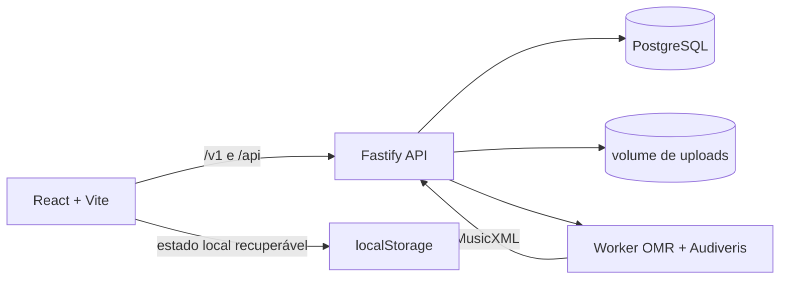

# Arquitetura da aplicação

## Objetivo

Cavaquinho Lab transforma estudo de cavaquinho em práticas editáveis: formas
de acordes, sequências, braço, escalas, solos, treino de ouvido e importação
de partituras. A interface preserva a cifra escrita, permite escolher uma
digitação tocável e exporta o estudo resultante.

## Componentes

### Interface

`src/pages` organiza as rotas e `src/components` reúne os controles de cada
superfície. `src/domain` contém as regras sem efeitos externos: interpretação
de cifra, notas, escalas, posições, sequência, exportação e prática. A base de
formas é uma dependência fixada por commit. A interface usa a mesma afinacão
de cavaquinho D–G–B–D para diagramas, braço e validação de voicings.

### Sequências e formas

Uma sequência preserva a cifra da partitura por ocorrência. A seleção do
músico é uma forma separada da estrutura harmônica: pode ser uma posição da
biblioteca ou uma posição personalizada. O resolvedor filtra posições sem
nota, fora do acorde ou fora da extensão suportada do braço e classifica as
restantes por tons definidores, cobertura, região, movimento da forma anterior
e preferência do músico.

### API e dados privados

`apps/api` expõe:

- `/api/health` para disponibilidade do processo;
- `/api/ready` para disponibilidade com OMR habilitado;
- `/v1/score-imports` para upload, importação, revisão e criação de práticas;
- `/v1` para produto, conta e cobrança.

Em desenvolvimento, a autenticação usa a identidade local e arquivos ficam no
volume Docker `score_import_files`. PostgreSQL no volume `score_import_db` é a
fonte de verdade para importações e dados autenticados. Em produção, Supabase
pode assumir autenticação e armazenamento privado.

### Importação de partitura

O navegador solicita uma URL de upload, envia o arquivo e cria a importação.
A API valida a propriedade do arquivo e agenda o worker. O worker aplica
Audiveris e normalização MusicXML. A API armazena um rascunho revisável; após a
validação, ele produz uma sequência de acordes e/ou uma prática de melodia.

## Desenvolvimento local

| Comando | Serviços | Uso |
| --- | --- | --- |
| `npm run dev` | Interface Vite | Formas, sequências, braço e prática sem importação. |
| `npm run dev:api` | API Fastify | Desenvolvimento isolado da API. |
| `npm run stack:up` | Interface, API, PostgreSQL e OMR | Fluxo completo de Partitura. |
| `npm run stack:verify` | Verifica a stack em execução | Saúde, CORS e MusicXML para práticas. |
| `npm run stack:down` | Encerra a stack | Mantém banco e uploads locais. |

A stack integrada abre em `http://127.0.0.1:5173/cavaquinho-lab/`. Para usar
uma interface Vite adicional em `127.0.0.1:4180`, a origem já está incluída na
lista local de CORS da API. Origens adicionais devem ser declaradas em
`CORS_ALLOWED_ORIGINS`.

## Verificação

| Camada | Verificação | O que protege |
| --- | --- | --- |
| Domínio e interface | `npm test` | Cifras, tons, formas, sequências, exportação e componentes. |
| API | `npm run test:api` | Contratos, CORS, propriedade e revisão de importação. |
| Worker | `npm run test:omr` | Normalização e pipeline OMR. |
| Navegador | `npm run test:e2e` | Fluxos de teclado, responsividade, prática e telas de importação. |
| Stack | `npm run stack:verify` | Frontend, API, readiness, PostgreSQL, worker, CORS e MusicXML para sequência e melodia. |
| Qualidade | `npm run audit:ui`, `npm run lint`, `npm run typecheck`, `npm run build` | Acessibilidade, consistência, tipos e bundle. |

O CI executa as verificações unitárias, API, OMR, navegador e build em cada
push e pull request. Após elas, inicia a stack completa em Docker e executa a
verificação de recursos. O deploy de produção só é elegível depois desses
gates; GitHub Pages publica somente a interface e mantém importação desativada
até que exista uma API pública configurada.

## Limites de publicação

GitHub Pages e builds estáticos não incluem API, banco, uploads ou Audiveris.
Por isso, uma implantação estática não oferece o recurso **Partitura**. O
ambiente completo precisa publicar a API e o worker junto de PostgreSQL ou dos
serviços gerenciados equivalentes, definir uma URL HTTPS pública em
`VITE_API_URL` e permitir essa origem em `CORS_ALLOWED_ORIGINS`.
